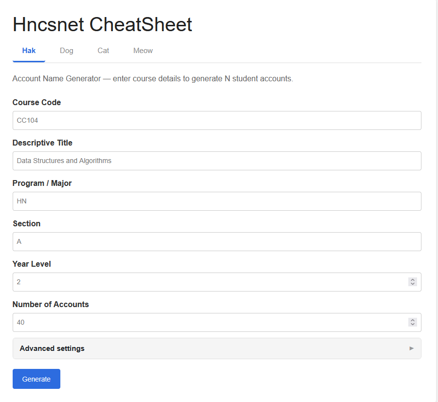
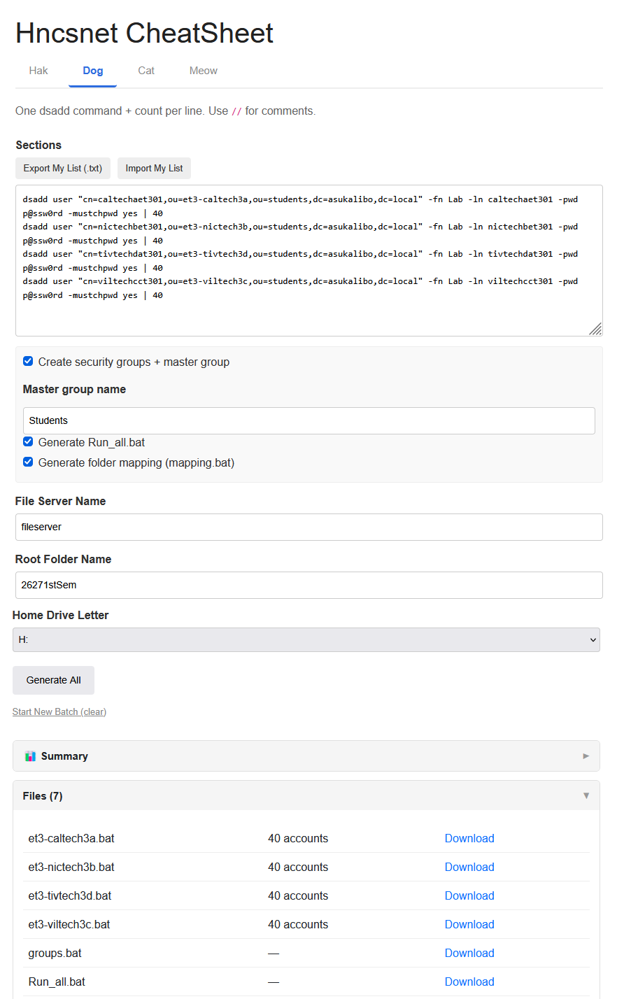
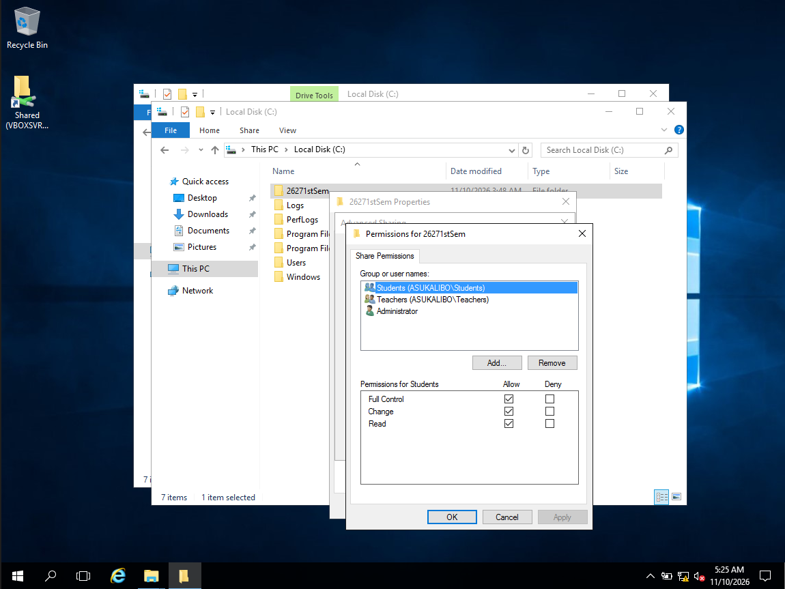
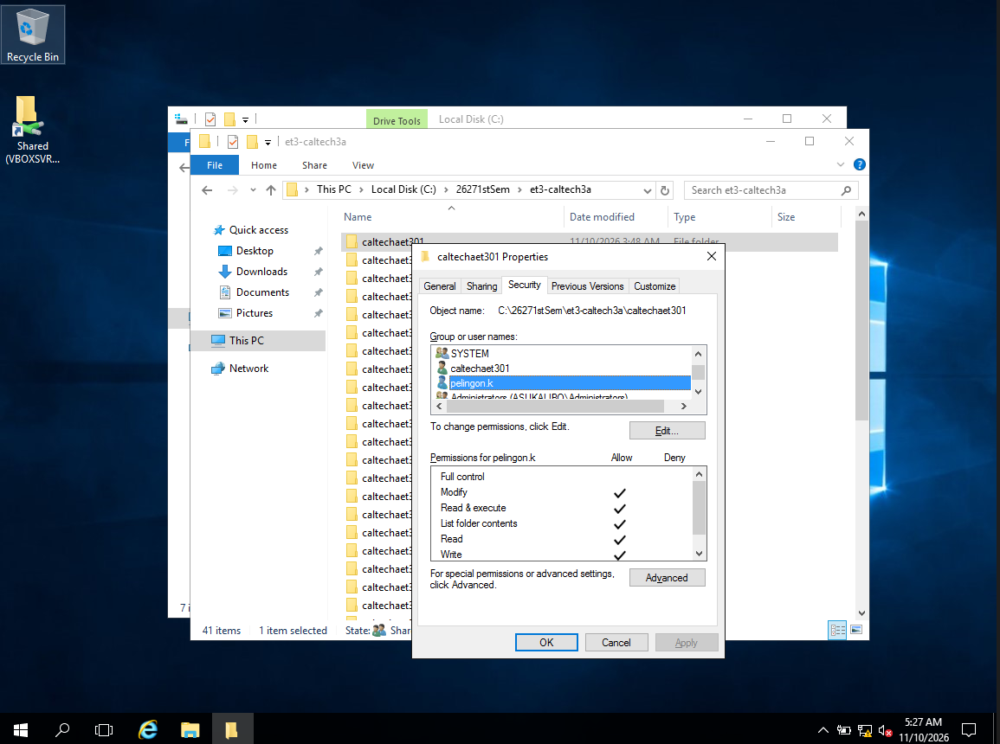
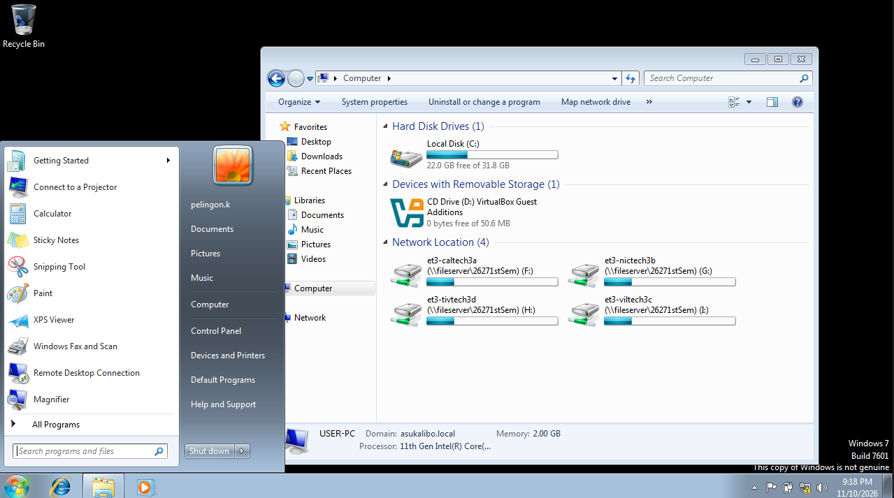
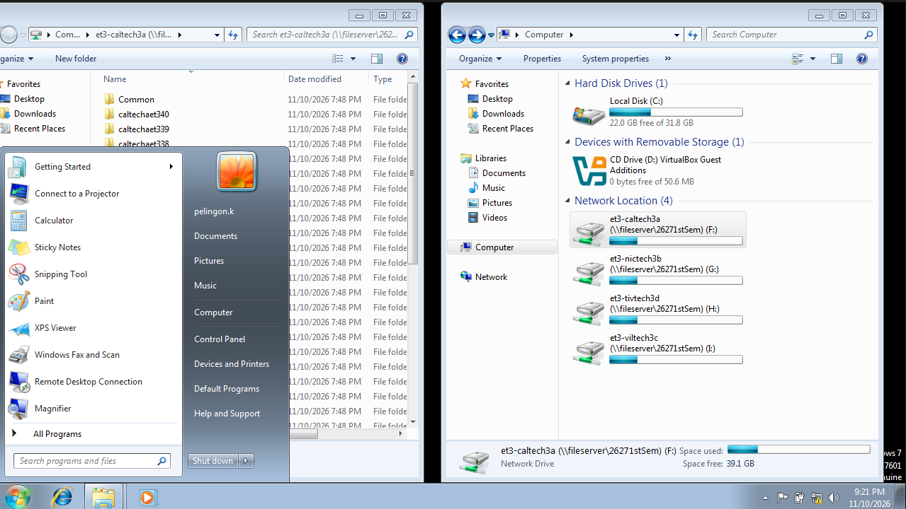
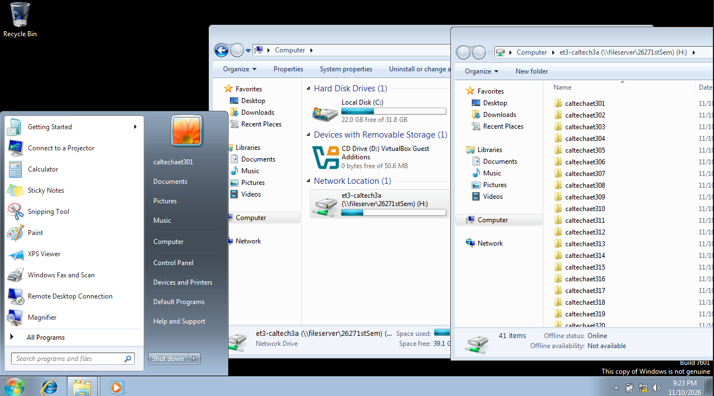
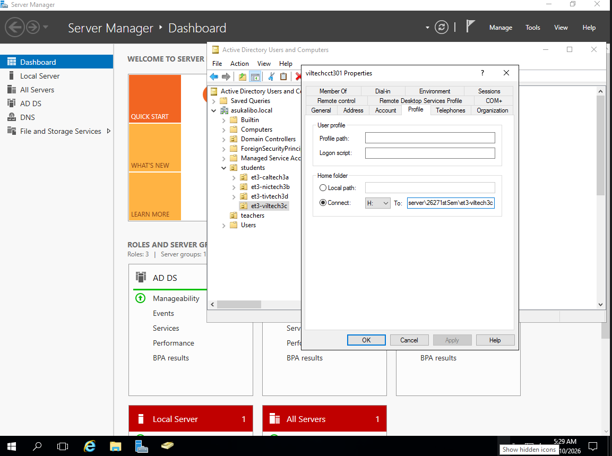
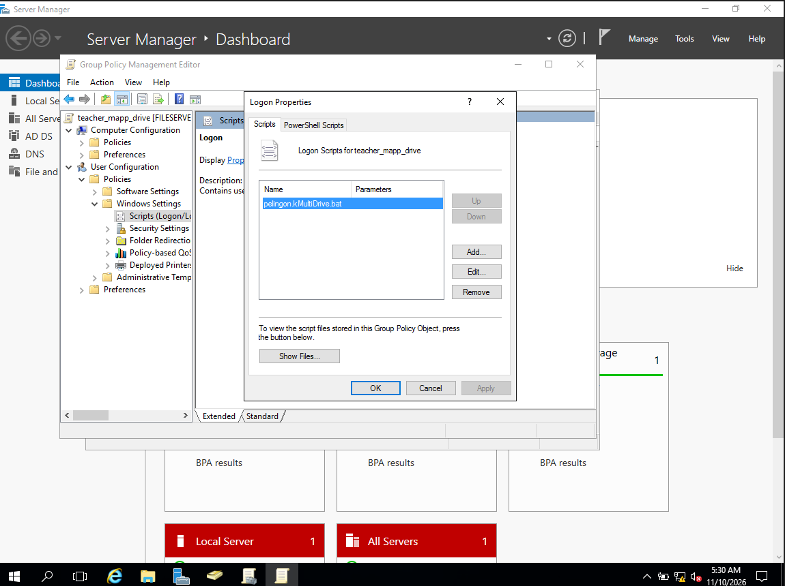
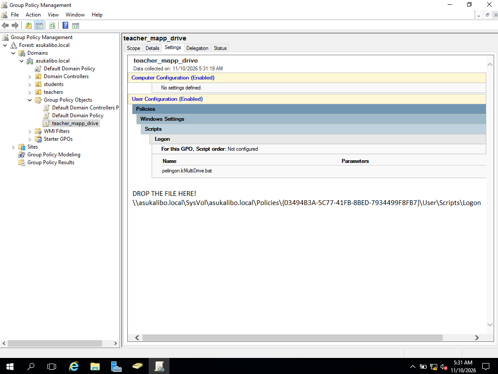

# Hncsnet CheatSheet (AD Bulk User Generator)

This is a personal, web-based utility designed to automate the creation of Windows Server Active Directory (AD) deployment scripts. It takes simple text inputs or baseline commands and generates fully structured `.bat` scripts to bulk-create users, organizational units (OUs), security groups, and mapped network drives.

## Features

* **Hak Tab (Single Section):** Provide one baseline `dsadd` command and it will automatically generate a batch file for the entire section with incremented usernames (e.g., `user101`, `user102`).

* **Dog Tab (Multi-Section):** Paste a list of baseline commands and user counts (e.g., `dsadd ... | 45`) to generate scripts for multiple sections simultaneously.

* **Automated Group Generation:** Automatically generates scripts to create Security Groups for each section and assigns the generated users to their respective groups.
* **Network Drive Mapping:** Generates `mapping.bat` to automatically create section and user folders on a file server, apply correct NTFS permissions (using `icacls`), and map them as home drives in AD.
* **Run-All Automation:** Generates a master `Run_all.bat` script that creates the OU structure and triggers all individual section scripts in the correct order.
* **Anomaly Detection:** Built-in verification engine that detects typos, inconsistent domains, and mismatched flags in the input commands before generating the scripts.
* **ZIP Export:** Downloads all generated `.bat` scripts neatly organized into a single ZIP archive.

## Usage

This tool is designed to run on a local PHP environment (like XAMPP) or a basic web server.

1. Drop the files into your web server directory (e.g., `htdocs`).
2. Navigate to the tool via your browser.
3. Use the **Hak** tab for quick, single-section generation, or the **Dog** tab for parsing large multi-section lists.
4. Download the generated `.bat` scripts or the full ZIP archive.
5. Move the scripts to your Windows Server and run them as an Administrator to populate Active Directory.

## Note
This is a personal workflow tool tailored for a specific deployment environment. Folder structures, domain suffixes, and group hierarchies are hardcoded or specifically tailored to the expected input format.

## Root folder sharing permission

## Root folder NTFS permission

## Teacher Multi Drive

## 

## Section NFTS

## student mapping

## student home folder path

## Multi Teacher Drive

## Drop the file here
" \\asukalibo.local\SysVol\asukalibo.local\Policies\{03494B3A-5C77-41FB-8BED-7934499F8FB7}\User\Scripts\Logon "
